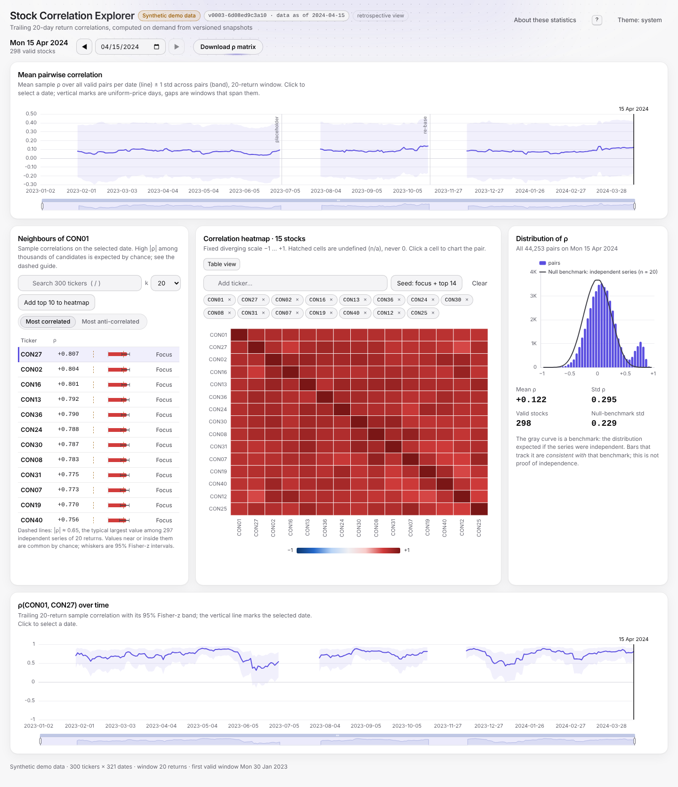

# Stock Correlation Explorer

**What it is:** a database-free system for exploring **trailing 20-day return correlations** across ~5,000 stocks by date.
- It reads daily price CSVs straight from a `.zip`, cleans them, and stores only O(T·N) data: 18 MB of returns plus small aggregates.
- It computes any correlation on demand, from a single pair up to the full 5,000 × 5,000 matrix.
- A FastAPI backend serves a React app. Every published dataset version is immutable, so new dates and price corrections arrive as new snapshots without disturbing readers.



*Screenshot: the synthetic demo dataset (`make demo`). It is labelled "Synthetic demo data" in the app.*

---

## 1. Quick start

You need Python ≥ 3.11 and Node ≥ 20.19.

```bash
python -m venv .venv && source .venv/bin/activate
pip install -r requirements.txt && pip install -e .
(cd app/web && npm ci)
```

| Goal | Command | Notes |
|---|---|---|
| **Demo, no private data needed** | `make demo` | Generates a deterministic synthetic dataset, builds it, builds the UI and serves everything on http://localhost:8000. |
| Demo update events | `make demo-update` | Publishes two new snapshots: one appends the next business day, the other corrects a historical price. The running API switches to the new snapshot within ~2 s (it polls `CURRENT`); an open browser tab keeps its version and shows a "newer version" banner within ~10 s, with a button to switch. |
| Real dataset | `make audit build-data api` | The Makefile uses `data/raw/stock_data.zip`, or `stock_data.zip` at the repository root if that is where it is (override with `ZIP=path`). Audit ≈ 20 s, build ≈ 65 s on 4 cores. |
| Add or correct days | `make ingest FILES="path/20240909.csv" REASON="..."` | Creates a new snapshot; only the affected windows are recomputed. |
| Inspect or roll back versions | `make snapshots ARGS="list"`, `ARGS="rollback v0001-…"` | `verify`, `prune --keep N` and `unlock` are also available. |
| Frontend dev server | `make web` | http://localhost:5173, proxying `/api` to `:8000`. |
| Tests | `make test`, then `cd app/web && npm run lint && npm run test && npm run build` | Python suite; frontend lint, unit tests, production build. |
| Benchmarks | `make bench` | Writes `reports/bench.md`. |

Without `make` (for example on Windows), run the same Python modules directly:

```bat
python -m corrlib.demo --out data\demo
python -m corrlib.build --zip data\demo\demo_stock_data.zip --out data\demo\store
set CORR_DATA_DIR=data\demo\store && python -m uvicorn app.api.main:app --port 8000
python -m corrlib.ingest --root data\demo\store data\demo\updates\append\20240415.csv
python -m pytest -q
```

---

## 2. What the brief asked for, and where it lives

| Requirement | Where |
|---|---|
| Read daily CSVs directly from one zip (no extraction) | `corrlib/io.py`: streams members and validates the header. Tickers are read as text, so the real ticker `NA` survives. |
| Clean and validate data, counting every issue | `corrlib/clean.py` (per-file rules and `IssueCounts`), `corrlib/returns.py` (uniform-price anomaly records) |
| Trailing 20-day correlations for ~5,000 stocks | `corrlib/corr.py`: pure numpy, `C = ZᵀZ` on standardised windows |
| Efficient on-disk storage, no database | `corrlib/store.py` and `corrlib/snapshots.py`: `.npy` memmap, Parquet, JSON, plus an atomic pointer file |
| Python API | `app/api/` (FastAPI, `/docs`) |
| React UI to explore by date | `app/web/` (Vite, React, TypeScript, TanStack Query, ECharts, Tailwind with Aceternity-style components) |
| Tests | `tests/` (pytest), `app/web/src/**/*.test.ts(x)` (vitest) |
| Docs and reproducibility | This README, `reports/data_audit.md`, `reports/bench.md`, `make demo` |

---

## 3. Architecture and trade-offs

```
 stock_data.zip ─► io (stream) ─► clean (per file) ─► wide prices [T×N] ─► uniform-day records ─► returns [T×N]
                                                                                                   │
            ┌───────────────────────── snapshot v000k (immutable directory) ◄──────────────────────┘
            │  returns.npy (float32, memmap) · prices.parquet (raw + used) · daily_stats · hist · anomalies.json
            │  inputs.json (sha256 of every source day) · manifest.json (checksums, policy, changes)
            ▼
   CURRENT ──► FastAPI registry (one snapshot per request, ?snapshot= pinning) ──► React UI (snapshot id in every query key)
            ▲
 corrlib.ingest (new dates / corrections) ── builds v000k+1 from the parent snapshot, recomputes only affected windows
```

- **Store returns, not correlations.**
  - Returns cost O(T·N): 900 × 5,000 × 4 B = **18 MB**.
  - Every date's matrix would cost O(T·N²): 900 × 12.5M pairs × 4 B ≈ **45 GB**.
  - From the returns, one stock against all others takes ~1 ms, a 150-stock matrix ~10 ms, and a full date ~30 ms of BLAS.
- **Memory-mapped `.npy`.** A query touches only W + 1 contiguous rows. There is no parse step, and the OS page cache is shared between processes.
- **Precomputed aggregates.** Each date's mean/std of ρ and its 40-bin histogram need all 12.5M pairs (~60 ms per date), so they are computed once per snapshot (~300 kB in total). That makes the timeline and the distribution panel instant.
- **Bounded memory for the full matrix.** It is streamed in row blocks (256 × N), so the server never holds an N × N matrix.
- **No database.** Nothing here is relational or needs transactions beyond "publish one complete version". A pointer file swapped with `os.replace` provides that.
- **Fixed W = 20 with complete observations only (§4).** This is an intentional correctness choice: it keeps `C = ZᵀZ` exact and every view consistent.
- **Where the design stops scaling:**
  - **Large universes.** A full matrix grows as N²; at N = 50k, one date is 10 GB as float32. The histogram build cost also grows as N²·T.
  - **Heavy concurrent full-matrix demand.** It is CPU-bound and capped at 2 concurrent downloads.
  - **Very frequent updates.** Every snapshot is a full copy, about 60 MB at N = 5,000.

---

## 4. Data and validity policy (one rule everywhere)

**Returns.** `R[t] = P[t]/P[t−1] − 1` over the calendar of file dates. `R[0]` is undefined. Nothing is forward-filled: a missing price makes both adjacent returns NaN.

**Validity.** A stock's 20-day correlation as of date t is defined only if all of the following hold:
- t ≥ 20;
- all 20 returns in its window are finite;
- the returns are not constant.

Otherwise every correlation involving it, **including its correlation with itself**, is undefined. The API returns one of these reason codes:

| Reason code | Meaning |
|---|---|
| `insufficient_history` | t < W |
| `missing_returns` | A missing or invalid price, not yet listed, delisted, or a structural break in the window |
| `constant_returns` | Zero variance, so Pearson correlation is undefined |

Undefined values are `null` in JSON, NaN in exports and hatched "n/a" in the UI. They are never 0 and never ranked.

The same `corr.window_status` function drives every view: pair series, row, matrix, rankings, daily summary, histogram and download.

**Universe.** The universe is the growing union of tickers. A ticker absent on a date is missing that day. Listings and delistings appear as missing history. Symbol renames are not linked.

**Uniform-price anomalies (§5).** These are dates where every ticker has the same price. Each one becomes an **evidence record**, served by `/api/meta.anomalies` and in the UI, containing:
- the original value;
- the classification (`rebase` / `placeholder` / `unresolved`);
- the status (`inferred` / `confirmed` / `unresolved`);
- the rule and its evidence numbers, and the observation dates used;
- whether the rule **looked ahead** to the next day;
- the action taken and the window-end dates affected.

Raw prices are never destroyed: `prices.parquet` keeps `price_raw` next to the `price` actually used. Ambiguous cases can be settled with an auditable overrides file (`--overrides`), which marks them `confirmed`.

**Retrospective view (look-ahead).** Classifying an interior uniform-price day d compares day d+1's prices with d and with d−1, so the decision for d uses an observation that did not exist on day d. The published history is therefore a *retrospectively cleaned* view, not a point-in-time one:
- What changes: whether the return into d is undefined (re-base) or the prices on d are excluded (placeholder). That decides which window-end dates d … d+20 have valid correlations. Correlations for windows that do not contain d are never affected.
- Point-in-time behaviour: a snapshot whose **last** date is uniform cannot classify it. That date stays `unresolved`, its prices are excluded and its raw values kept. When the next day is ingested, the new snapshot classifies it, recomputes the affected windows and records the change in `changes.anomaly_changes`. The earlier snapshot is not rewritten and stays readable (`?snapshot=`).
- The API reports `view: "retrospective"`, and each anomaly record carries `look_ahead: true/false` and the observation dates used. The UI's "About these statistics" dialog says the same.

**Deterministic ranking.** Top-k is ordered by (ρ descending, column index ascending), and bottom-k by (ρ ascending, index ascending). It is stable even with thousands of exact ties.

---

## 5. What the real data looks like (`reports/data_audit.md`)

- **Files and rows:** 900 daily files, 2020-01-01 → 2024-09-06, 5,000 tickers in every file (4.5M rows). The ticker `NA` is present.
- **Date formats:** 10,000 rows (two whole files) use `M/D/YYYY` dates.
- **Missing prices:** 6, all on 2022-05-30.
- **No other defects:** no duplicates, non-numeric or non-positive prices, or weekend files.
- **Calendar:** five yearly blocks of about 180 days, separated by gaps of 114–116 days.
- **Uniform-price days:**
  - **Re-bases at 20.0** (2020-01-01, 2020-12-31, 2021-12-31, 2023-01-02, 2024-01-01). Prices continue from 20.0, so only the return *into* each day is undefined.
  - **One placeholder at 1.0** (2021-02-22). Prices continue from the previous day, so that day's prices are excluded.
  - All six are `inferred` (no overrides). The five interior ones (every date except 2020-01-01) were classified using the next day's prices, so `look_ahead: true`. The first date, 2020-01-01, needed no look-ahead.
  - Without this handling, returns reach 747× and 19,101 exceed 50%. With it, the largest is 44%.
- **Validity:** the first valid window is 2020-01-29. 101 later dates have no valid window, because their window spans a re-base or the placeholder.

**Statistical reading, kept to what the analysis shows:**

| | |
|---|---|
| **Observation** | Per-date mean pairwise ρ stays within ±0.0002, and the per-date std of ρ is 0.229. Over the full sample, pairwise ρ has std 0.0335 and max \|ρ\| 0.177. |
| **Inference** | These figures are *consistent with an independent-series null model* (std ≈ 1/√(W−1) = 0.229 for W = 20). At this window length these summaries do not reveal a common factor; that is absence of evidence, not evidence that none exists. |
| **Limitations** | This does **not** prove the stocks are independent, nor that every correlation is noise. Weak factors or nonlinear dependence would not show up in these summaries. |

**Short-window uncertainty and multiple comparisons.**
- With 20 returns, the sampling std of r near 0 is about 0.23. A 95% Fisher-z interval around r = 0.5 is roughly [0.07, 0.77].
- Under the independent-series null, the largest |ρ| among 4,999 candidates is typically about 0.75 (audit §8). A top neighbour that extreme is therefore not, on its own, evidence of a stable relationship; neither is it proof that the relationship is noise.
- The UI therefore shows confidence bands and a null-benchmark guide, and labels top/bottom neighbours as sample correlations, not stable relationships.

---

## 6. API (`/docs` for the live schema)

Every data endpoint accepts `?snapshot=<id>` to pin a version, and every response carries `X-Snapshot-Id`. Errors are always `{"detail": {"code", "message", …}}`.

| Endpoint | Returns |
|---|---|
| `GET /api/health` | status, snapshot id, shape |
| `GET /api/snapshots` · `/api/snapshots/current` · `POST /api/snapshots/reload` | the version list, the current version, and an explicit reload (the server also polls `CURRENT` every 2 s) |
| `GET /api/meta` | tickers, dates, first valid date, snapshot, `view`, `dataset` (source or demo), `policy`, `anomalies` |
| `GET /api/stats/timeline` | per-date mean/std of ρ and `n_valid` |
| `GET /api/dates/{date}/summary` | n_valid, n_pairs, mean, std, histogram, `status` |
| `GET /api/corr/{date}/stock/{ticker}?k=20` | `valid`, `reason`, top/bottom k (k ≤ 200, deterministic) |
| `GET /api/corr/{date}/matrix?tickers=A,B,…` | k × k matrix (2–150 tickers), `valid[]`, `reasons[]` |
| `GET /api/corr/pair?a=&b=&start=&end=` | ρ(a, b) over the date range |
| `GET /api/corr/{date}/row/{ticker}` | all N correlations (in `meta.tickers` order), `valid`, `reason` |
| `GET /api/corr/{date}/download?dtype=float32\|float16&format=npz\|npy` | Streamed full matrix. **float32 is the default** (within 1e-6 of the API values); float16 is a size-saving option (within 1e-3). The `npz` file is self-describing: `corr`, `tickers`, and `meta` (date, window, snapshot, dtype, shape, ticker order, invalid semantics). At most 2 concurrent downloads; computation stops when the client disconnects. |
| `GET /api/corr/{date}/download/info` | exact size, filename and metadata, shown before downloading |

**Error codes:** `invalid_date`, `invalid_input`, `date_not_traded` (with the nearest dates), `date_before_first_window` (with `first_valid_date`), `unknown_ticker` / `unknown_tickers` (with suggestions), `snapshot_not_found`, `too_many_downloads` (429), `not_found`, `internal_error`.

A date inside the calendar with no valid window returns 200 with `null`s and `status: "no_valid_pairs"`.

---

## 7. New data, corrections and publication

```bash
python -m corrlib.ingest --root data/processed 20240909.csv --reason "daily load"   # append
python -m corrlib.ingest --root data/processed 20230508.csv --reason "vendor fix"   # correction
python -m corrlib.snapshots --root data/processed list | verify | rollback ID | prune --keep 5 | unlock
```

**Identity.** A file is identified by its date (from the file name) and the sha256 of its bytes. Every source day's hash is recorded in `inputs.json`, including each base-zip member, so:
- re-importing identical content is a **no-op**, recorded as `duplicate`;
- different content for an existing date is a **correction**;
- a new date is an **append** or an **insert**.

**What gets rebuilt.** The new snapshot is built from the parent's raw prices; the zip is not re-read. Anomalies are re-classified. Return rows are compared by date, and only window-end dates whose window touches a changed return are recomputed; all other aggregates are copied unchanged.
- A one-price correction at date index p recomputes exactly the 21 window ends p … p+20.
- On the demo data, an append took 0.16 s end to end and a correction 0.16 s.

**Publication.** A new snapshot is built in `snapshots/.staging-*`, then verified: checksums, shapes, histogram totals and calendar order. It is renamed into place, and only then is `CURRENT` replaced atomically (temp file + fsync + `os.replace`).
- An interrupted build or ingest leaves the previous version published and readable.
- Old snapshots stay on disk for in-flight readers and for rollback until an explicit `prune`, which never removes `CURRENT`.
- A lock file enforces a single writer.
- `ingest_log.jsonl` records every attempt with its status (`published` / `duplicate` / `rejected` / `failed`) and reason, so a failed update can simply be re-run.

**Readers.** The API resolves one snapshot per request and serves it from that snapshot's own immutable files, so a response never mixes versions. While a new snapshot is being built, requests keep being served by the current one. The UI puts the snapshot id in every query key:
- a browser tab stays on the version it loaded, so every panel shows the same snapshot;
- it polls `/api/snapshots/current` every 10 s and shows a "newer version" banner with a **Switch to latest** button;
- any version can be requested explicitly with `?snapshot=<id>`, and is served for as long as it exists on disk.

**Downloads in flight.** A full-matrix download captures its snapshot when it starts, and finishes from it even if a newer snapshot is published meanwhile. At most 2 downloads run at once; a third gets 429 `too_many_downloads` with `Retry-After`. If the client disconnects, the server stops computing within a block and frees the slot. `tests/test_api_streaming.py` checks all three against a live server.

---

## 8. Performance

Measured by `make bench` on the real data (900 × 5,000) on a 4-CPU Linux container. Full figures, method and cache state are in [`reports/bench.md`](reports/bench.md).

| | Warm, in-process p50 |
|---|---:|
| one stock vs all (top/bottom 20) | ~6 ms |
| 100-ticker matrix | ~9 ms |
| pair over 900 dates | ~4 ms |
| full float32 matrix (100 MB) streamed over HTTP | ~0.5 s |

**Build times:**
- full build from the zip: about 70 s;
- demo full build: about 2 s;
- demo append or correction: about 0.2 s.

These are single-machine, warm page-cache numbers, not guarantees. Cold reads add the cost of paging in 21 rows of `returns.npy`, which is small. Full-matrix downloads are CPU-bound and deliberately capped.

---

## 9. Testing

```bash
make test                                  # pytest: io, clean, returns, corr, policy, anomalies, store,
                                           #   snapshots, ingest, demo, API
cd app/web && npm run lint && npm run test && npm run build
```

What the tests cover:
- **Validity policy:** every edge case on a hand-made reference dataset (missing price, listing, delisting, constant series, t < W).
- **Rankings:** deterministic, including thousands of exact ties.
- **Anomalies:** a uniform last date, a re-base, a placeholder, and overrides.
- **Snapshots:** atomic publish, an interrupted build, rollback, prune and the lock.
- **Ingest:** duplicate no-op, append equal to a full rebuild, and a correction that changes exactly 21 window ends.
- **API:** error envelopes, snapshot pinning, the npz export matching the API values, and cross-endpoint agreement.
- **Streaming, against a live uvicorn server** (`tests/test_api_streaming.py`):
  - the overlapping-download cap (a real 429 with two downloads open);
  - a client disconnect mid-stream for npy and npz, checking that computation stops and the slot is released;
  - all four dtype/format exports against the API row values;
  - a snapshot published during an active download.
  Block production is gated by a semaphore the test controls, so there are no timing sleeps.
- **Frontend:** the stale-result guard in the UI.

---

## 10. Status

**Implemented now:**
- everything in §1–§9;
- an accessible, keyboard-friendly UI with:
  - shortcuts: ←/→ change date, `/` searches, `?` shows help;
  - a table view for the heatmap, and focus-trapped dialogs;
  - Fisher-z confidence bands and a null-benchmark guide;
  - snapshot awareness, stale-result guards, light and dark mode, and reduced motion.

**Not implemented / limitations:**
- Snapshots are full copies (~60 MB each for the real data); there is no deduplication between versions.
- Symbol renames are not linked across history.
- The window is fixed at 20, and there is no pairwise-missing mode; both are deliberate (§4).
- The API has no authentication or rate limiting beyond the download cap.
- Benchmarks come from one machine.
- The anomaly rule cannot tell apart two consecutive uniform days with the same value; that case needs an override.

**Possible extensions (not built):**
- deduplicated or chunked snapshot storage;
- multiple window lengths;
- an optional pairwise-complete mode;
- tile caching for heavy all-pairs workloads;
- p-values or FDR-adjusted significance next to ρ;
- auth and quotas for public deployment.
